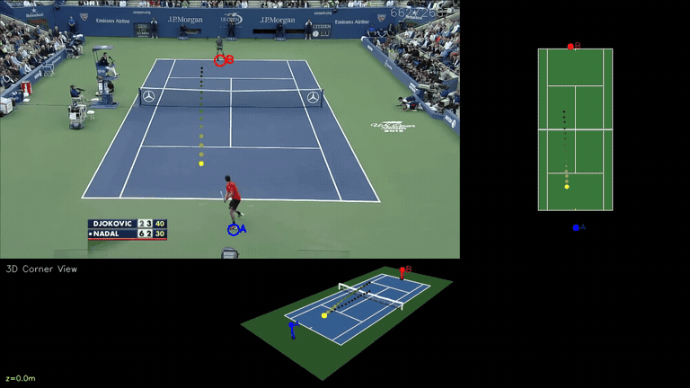

# Tennis Video Player/Ball Tracking and Court-Plane Coordinate Extraction

A command-line pipeline that tracks players and the ball in tennis match footage, exports court coordinates, and estimates ball height for an optional 3D replay.

## Match preview



The yellow trail follows the ball in each view. The 3D panel shows the estimated height above the court in meters.

## Quick Start

```bash
# Clone and enter the project
git clone <repo-url> tennis-video-extraction
cd tennis-video-extraction

# Create environment with uv
uv sync

# Run tests
uv run pytest tests/ -v

# Check lint
uv run ruff check .

# View all commands
uv run python -m tennis_tracker --help
```

## Prerequisites

- **Python 3.11+**
- **uv** (package manager) — install with `curl -LsSf https://astral.sh/uv/install.sh | sh` or `brew install uv`
- **Apple M-series Mac** recommended for production use (standard M1 target)
- **Roboflow API key** only needed for dataset download (see Dataset Preparation)

## Project Structure

```
tennis-video-extraction/
  docs/
    spec.md                    # Full specification
    implementation-plan.md     # Implementation plan
  data/
    input/                     # Local input videos (gitignored)
    output/                    # Generated CSV/video outputs (gitignored)
    datasets/                  # Downloaded/exported datasets (gitignored)
  models/
    README.md                  # Model artifact documentation
  scripts/
    prepare_roboflow_dataset.py
  src/
    tennis_tracker/
      __init__.py
      __main__.py              # CLI entry point (uv run python -m tennis_tracker)
      cli.py                   # Argument parsing and dispatch
      types.py                 # Core data contracts
      diagnostics.py           # Diagnostic flag utilities
      output.py                # CSV writer
      court.py                 # Court geometry constants
      coordinates.py           # Homography and projection
      smoothing.py             # Temporal interpolation
      video.py                 # Video IO utilities
      pipeline.py              # Process pipeline
      detection.py             # YOLO inference wrappers
      tracking.py              # Player/ball tracking assignment
      optimization.py          # Model export/optimization workflow
      benchmark.py             # Benchmark reporting
      render.py                # Annotated video rendering
      validation.py            # Validation metrics
      training/
        __init__.py
        ball.py                # Ball detection training CLI
        court.py               # Court keypoint training CLI
      train_ball.py            # Shim for python -m tennis_tracker.train_ball
      train_court.py           # Shim for python -m tennis_tracker.train_court
  tests/
    unit/                      # Unit tests
    integration/               # Integration tests
```

## Dataset Preparation

> **Note:** You only need this step if you plan to train/fine-tune models yourself.
> The first-version player detector uses pretrained COCO YOLO26 (no training needed).

Create a local `.env` file for your Roboflow API key:

```bash
cp .env.example .env
# Edit .env and replace the placeholder:
# ROBOFLOW_API_KEY=your_key_here
```

`.env` is gitignored; do not commit real secrets.

The project supports two Roboflow datasets approved in the spec:

| Dataset | Workspace/Project | Model Task |
|---|---|---|
| Court keypoints | `abiya-thesis/tennis-court-suuzy` | YOLO26 pose/keypoint |
| Ball detection | `viren-dhanwani/tennis-ball-detection` | YOLO26 detection |

```bash
# Download court dataset; the helper reads ROBOFLOW_API_KEY from .env by default
uv run python scripts/prepare_roboflow_dataset.py --dataset court

# Download ball dataset
uv run python scripts/prepare_roboflow_dataset.py --dataset ball

# Dry-run without downloading
uv run python scripts/prepare_roboflow_dataset.py --dataset court --dry-run

# Use a non-default env file if needed
uv run python scripts/prepare_roboflow_dataset.py --dataset ball --env-file .env.local

# View all options
uv run python scripts/prepare_roboflow_dataset.py --help
```

Datasets are downloaded to `data/datasets/` (gitignored).

## Training

### Ball detection model

```bash
uv run python -m tennis_tracker.train_ball \
  --data data/datasets/viren-dhanwani-tennis-ball-detection/data.yaml \
  --base-model yolo26n.pt \
  --output models/ball_yolo26.pt \
  --device cpu
```

### Court keypoint model

```bash
uv run python -m tennis_tracker.train_court \
  --data data/datasets/abiya-thesis-tennis-court-suuzy/data.yaml \
  --base-model yolo26n-pose.pt \
  --output models/court_keypoints_yolo26.pt \
  --device cpu
```

Both training CLIs support `--epochs`, `--imgsz`, `--batch`, and other YOLO arguments. View full options with `--help`.

### Training on Google Colab GPU (`colab` CLI)

If you have the Google Colab CLI (`colab`) installed and authenticated, you can train and iterate on GPU (e.g., `T4`, `L4`, `A100`) directly from this repository using `scripts/train_on_colab.py`:

```bash
# Preview the Colab workflow without allocating a VM
uv run python scripts/train_on_colab.py --task ball --dry-run

# Train ball detection on a Colab T4 GPU (recommended imgsz=1280 for small balls)
uv run python scripts/train_on_colab.py \
  --task ball \
  --gpu T4 \
  --epochs 100 \
  --imgsz 1280 \
  --output models/ball_yolo26.pt

# Train court keypoint detection on a Colab T4 GPU
uv run python scripts/train_on_colab.py \
  --task court \
  --gpu T4 \
  --epochs 100 \
  --output models/court_keypoints_yolo26.pt
```

The runner packages `src/`, provisions a Colab GPU session, downloads the dataset on the VM via `.env` (`ROBOFLOW_API_KEY`) or uploads `data/datasets/`, runs training on CUDA (`--device 0`), downloads the trained `.pt` weights plus `results.csv`/`args.yaml` to `runs/colab/<task>/`, and stops the session automatically. Pass `--keep-session` / `--reuse-session` to iterate across runs without recreating the VM.

## Automatic Model Optimization

Before running the main pipeline, models can be automatically optimized for CPU inference:

```bash
# Export to OpenVINO with INT8 quantization
uv run python -m tennis_tracker optimize-model \
  --input models/ball_yolo26.pt \
  --output models/optimized/ \
  --format openvino \
  --quantize int8
```

Supported formats: `onnx`, `openvino`. Supported quantization: `int8`, `fp16`.

When `--auto-optimize-models` is enabled (default) in the `process` command, the pipeline detects missing or stale optimized artifacts, exports and benchmarks ONNX/OpenVINO variants, and selects the fastest valid artifact. Falls back to the original `.pt` file if needed.

## Processing a Video

### On Google Colab GPU (recommended for faster inference)

```bash
# Default input (data/input/match.mp4) on a Colab T4 GPU
./scripts/process_video.sh

# Add the 3D corner view below the match footage and 2D court
./scripts/process_video.sh data/input/match.mp4 --3d-court-view
./scripts/process_video.sh data/input/match.mp4 --3d --gpu L4

# Dry-run without allocating a VM
./scripts/process_video.sh data/input/match.mp4 --dry-run
```

`scripts/process_video.sh` wraps `scripts/process_on_colab.py`, which uploads the video and local models (`yolo26n.pt`, `models/ball_yolo26.pt`, `models/court_keypoints_yolo26.pt`) to a Colab GPU session, runs `tennis_tracker process --device cuda` detached while polling logs, downloads the CSVs and annotated MP4 back to `data/output/`, and stops the session automatically.

### Locally (CPU / MPS)

```bash
uv run python -m tennis_tracker process \
  --input data/input/match.mp4 \
  --raw-output data/output/match_raw_coordinates.csv \
  --smoothed-output data/output/match_smoothed_coordinates.csv \
  --video-output data/output/match_annotated.mp4 \
  --player-model models/player_yolo26.pt \
  --ball-model models/ball_yolo26.pt \
  --court-model models/court_keypoints_yolo26.pt \
  --device cpu \
  --target-fps 30
```

The pipeline:

1. Loads models (or optimized artifacts)
2. For each frame: detects court keypoints, estimates homography, detects players and ball, tracks player labels, projects to court-plane coordinates
3. Writes raw CSV (unsmoothed per-frame detections)
4. Fills short tracking gaps, estimates ball height using detected bounces and hits, and writes the corrected court coordinates to the smoothed CSV
5. Renders the annotated video in a 16:9 layout

**Missing/low-confidence detections** produce diagnostic flags rather than crashes or fabricated coordinates.

## Benchmarking

```bash
uv run python -m tennis_tracker benchmark \
  --input data/input/match.mp4 \
  --player-model models/player_yolo26.pt \
  --ball-model models/ball_yolo26.pt \
  --court-model models/court_keypoints_yolo26.pt \
  --device cpu \
  --max-frames 100
```

Reports per-stage FPS (decode, court, player, ball, tracking/projection, rendering), total FPS, and pass/fail against the 30 FPS target.

## Validation

```bash
# Run with synthetic fixture (no real data needed)
uv run python -m tennis_tracker validate --synthetic-fixture

# Run with real validation annotations
uv run python -m tennis_tracker validate \
  --data data/validation/annotations.json \
  --player-model models/player_yolo26.pt \
  --ball-model models/ball_yolo26.pt \
  --court-model models/court_keypoints_yolo26.pt
```

Reports:
- Detection precision/recall (>99% target) for person/ball/court-keypoint tasks
- Coordinate tolerance pass rates: player positions ≤ 0.2 m, ball positions ≤ 0.1 m

## Outputs

### CSV Schema

The pipeline writes two CSV files with identical schema:

| Column | Description |
|---|---|
| `frame_index` | 0-based frame number |
| `time_s` | Timestamp in seconds |
| `player_a_x_m` | Player A court X (meters) |
| `player_a_y_m` | Player A court Y (meters) |
| `player_a_pixel_x` | Player A image pixel X (debug) |
| `player_a_pixel_y` | Player A image pixel Y (debug) |
| `player_a_confidence` | Player A detection confidence |
| `player_b_x_m` | Player B court X (meters) |
| `player_b_y_m` | Player B court Y (meters) |
| `player_b_pixel_x` | Player B image pixel X (debug) |
| `player_b_pixel_y` | Player B image pixel Y (debug) |
| `player_b_confidence` | Player B detection confidence |
| `ball_x_m` | Ball court X (meters) |
| `ball_y_m` | Ball court Y (meters) |
| `ball_pixel_x` | Ball image pixel X (debug) |
| `ball_pixel_y` | Ball image pixel Y (debug) |
| `ball_confidence` | Ball detection confidence |
| `court_confidence` | Court homography confidence |
| `homography_valid` | Whether homography projection is valid |
| `diagnostics` | Semicolon-separated diagnostic flags |

Missing values are represented as empty CSV cells (never 0 or "0").

### Annotated Video

The annotated MP4 is 1280 × 720 (16:9) by default. The source footage keeps its original aspect ratio and shows player markers, the ball trail, and tracking diagnostics. The 2D court beside it shows player and ball positions in court coordinates.

Pass `--3d-court-view` to add the 3D reconstruction below both views, as shown in the [match preview](#match-preview). The panel shows estimated ball height, which is not exported in the CSVs.

## Coordinate System

| Axis | Direction | Origin |
|---|---|---|
| X | Court width (positive to the right) | Center of full doubles court |
| Y | Court length (positive toward far baseline) | Center of full doubles court |

Court dimensions: 10.97 m (width) × 23.77 m (length). Singles width: 8.23 m.

## Testing

```bash
# Run all tests
uv run pytest tests/ -v

# Run only unit tests
uv run pytest tests/unit -v

# Run only integration tests
uv run pytest tests/integration -v

# Lint check
uv run ruff check .

# Auto-fix lint issues
uv run ruff check --fix .
```

## Target Hardware

- **Standard Apple M1** CPU (primary target)
- **30 FPS** real-time throughput on 1080p input
- ONNX and OpenVINO exports with quantization for CPU acceleration
- Tested on macOS; CPU-only execution path

## Artifact Gitignore Rules

The following are gitignored and **not committed** to the repository:

- `data/input/`, `data/output/`, `data/datasets/` — large data files
- `models/*.pt`, `models/*.onnx`, `models/*.xml`, `models/*.bin` — model weights
- `__pycache__/`, `.venv/` — Python build artifacts
- `.env` — credentials and secrets
- `htmlcov/`, `.coverage*` — test coverage reports

## References

- [Full Specification](docs/spec.md)
- [Implementation Plan](docs/implementation-plan.md)
